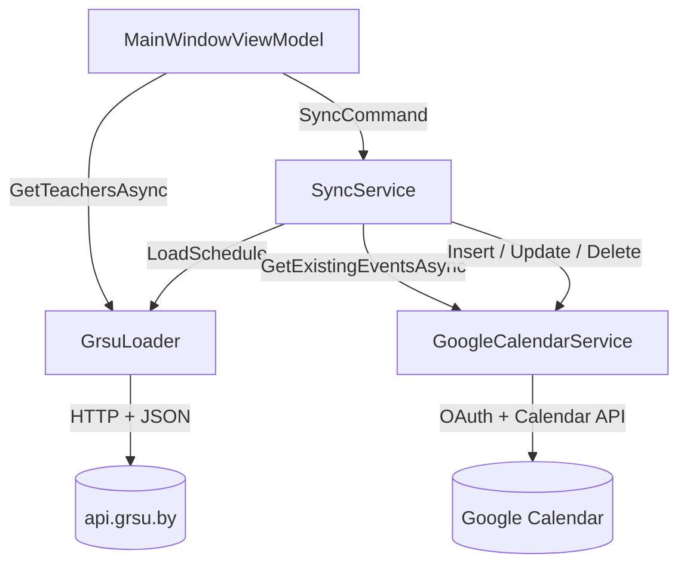

# GrSU Schedule → Google Calendar Sync

Desktop application that pulls a teacher's schedule from the Grodno State University (GrSU) public API and reconciles it into a dedicated Google Calendar.


## Screenshot

<!-- TODO: add screenshot to docs/screenshot.png -->


## Problem & Solution

GrSU provides teacher schedules through a public API, but they are not available as a calendar, so keeping them in Google Calendar means recreating dates and rooms manually. This application selects a teacher and a date range, loads the schedule from the GrSU API, and writes it into a dedicated Google Calendar. Every run reconciles instead of appending: existing events are updated, missing ones are inserted, and lessons that disappeared from the schedule are removed. Re-running the sync is idempotent within a single unpaginated `events.list` page; events beyond the first page are not reconciled. The OAuth token is cached locally.

## Features

- Teacher lookup over about 1,100 GrSU staff records with substring search.
- Start and end date selection through date pickers.
- Idempotent insert, update, and delete based on the university's lesson ID.
- Dedicated calendar `"ГрГУ Расписание"`, created automatically when absent.
- Google OAuth 2.0 desktop flow with a cached token in `token.json/`.
- Event details: lesson title and type, building and room, group list, and an `[ID: …]` marker in the description.
- Five-minute popup reminder on created events.
- Added / updated / deleted counts shown in the status area after each run.
- The teacher used in the last sync is stored in `settings.txt` and restored on the next launch.
- UI language: Russian.

## How it works

1. `SyncService` asks `GrsuLoader` for the schedule of the selected teacher and date range.
2. The returned days determine the reconciliation window: one day before the first returned day through one day after the last.
3. `GoogleCalendarService` lists events in the target calendar inside that window and indexes them by the `[ID: …]` marker parsed from each event description.
4. Each lesson is updated when its ID already exists and inserted otherwise.
5. Marked events in the window whose IDs are absent from the new schedule are deleted.
6. The operation totals are returned as a report and displayed in the UI.



## Architecture

`Calendar` is the Avalonia desktop application. `Schedule` is a class library containing the domain model, the GrSU loader, the Google Calendar client, and the sync orchestration. `SyncService` depends on `IScheduleLoader` and `ICloudCalendarService`; the current UI wires the GrSU and Google implementations. The UI uses CommunityToolkit.Mvvm source generators (`[ObservableProperty]`, `[RelayCommand]`) and Avalonia compiled bindings.

```text
.
├── Calendar/
│   ├── Assets/                  # background image and application icon
│   ├── Services/
│   │   └── SettingsManager.cs   # last teacher ID in settings.txt
│   ├── ViewModels/
│   │   ├── MainWindowViewModel.cs
│   │   └── ViewModelBase.cs
│   ├── Views/
│   │   ├── MainWindow.axaml
│   │   └── MainWindow.axaml.cs
│   ├── App.axaml / App.axaml.cs
│   ├── Program.cs
│   ├── ViewLocator.cs
│   ├── app.manifest
│   └── Calendar.csproj
├── Schedule/
│   ├── Models/
│   │   ├── DaySchedule.cs
│   │   ├── Lesson.cs
│   │   ├── Teacher.cs
│   │   └── TeacherSchedule.cs
│   ├── Services/
│   │   ├── GrsuLoader.cs
│   │   ├── GoogleCalendarService.cs
│   │   ├── SyncService.cs
│   │   ├── IScheduleLoader.cs
│   │   └── ICloudCalendarService.cs
│   └── Schedule.csproj
├── GoogleCalendarSync.sln
└── credentials.example.json
```

## Tech stack

| Technology | Version | Purpose |
| --- | --- | --- |
| .NET | 9 (`net9.0`) | Target framework and runtime |
| Avalonia (with ReactiveUI) | 11.3.6 | Desktop UI framework and ReactiveUI integration |
| CommunityToolkit.Mvvm | 8.4.0 | MVVM source generators |
| Google.Apis.Calendar.v3 | 1.72.0.3953 | Google Calendar API client |
| Google.Apis.Auth | 1.73.0 | OAuth 2.0 authorization |
| Newtonsoft.Json | 13.0.4 | GrSU JSON deserialization |

## Getting started

### Prerequisites

- .NET 9 SDK.
- A Google account.

### Google OAuth setup

1. Create or select a project in [Google Cloud Console](https://console.cloud.google.com/).
2. Enable the **Google Calendar API** for that project.
3. Configure the OAuth consent screen. If the app is in testing mode, add your Google account as a test user.
4. Open **Credentials** → **Create credentials** → **OAuth client ID** → **Desktop app**.
5. Download the JSON and save it as `credentials.json` in the repository root, or copy `credentials.example.json` and fill in the downloaded client values.
6. Start a sync. The first run opens the browser consent screen; the token is cached locally in `token.json/`.

The application resolves `credentials.json`, `token.json/`, and `settings.txt` relative to the process working directory. The commands below are run from the repository root, so the file belongs there.

### Build and run

```bash
dotnet restore GoogleCalendarSync.sln
dotnet build GoogleCalendarSync.sln
dotnet run --project Calendar
```

### Troubleshooting

- `You must install or update .NET` — the project targets .NET 9. Install the .NET 9 runtime/SDK, or, if only a newer runtime is available, run `DOTNET_ROLL_FORWARD=Major dotnet run --project Calendar`.
- Missing `credentials.json` — the teacher list still loads, but the first sync fails inside `GoogleCalendarService`. Because `SyncCommand` has no error handling, `IsBusy` remains `true`, no error is shown, the status area keeps its previous message, and further sync clicks are ignored. Place the file in the current working directory, which is the repository root when using the commands above.

## Usage

1. Start the application and wait until the teacher list is loaded.
2. Type part of a teacher's name and select the person from the filtered list.
3. Choose the start and end dates.
4. Click **ЗАПУСТИТЬ СИНХРОНИЗАЦИЮ** (Start synchronization). On the first run, complete the Google consent screen.
5. Read the added / updated / deleted counts and check the `"ГрГУ Расписание"` calendar.

> [!WARNING]
> Synchronization is destructive inside its window. It deletes events in `"ГрГУ Расписание"` whose description contains `[ID: …]` but whose ID is absent from the newly loaded schedule. Switching teachers without changing the date range therefore removes the previous teacher's lessons in that window. Events matched by ID are also overwritten: summary, description, start, end, and location are replaced with schedule data, so manual edits to those fields are lost. Events without the marker and events in other calendars are not touched. If the GrSU API returns no days, the sync exits without inserting or deleting anything.

## Design decisions

- **Server-side lesson ID as the sync key.** GrSU assigns an ID to every scheduled lesson. Storing it in the event description gives a stable identity across runs without a local database; updates and deletions are resolved from that marker alone.
- **A dedicated calendar instead of the primary one.** The app creates and targets `"ГрГУ Расписание"`, so reconciliation cannot remove unrelated user events and the generated schedule can be hidden or shared independently.
- **Reconciliation window from the actual response.** The window is derived from the first and last returned schedule day (±1 day), not from the requested range. This keeps boundary events in scope; when the API returns no days, `SyncService` exits early through its `Days.Count == 0` check and performs no Google requests.
- **Interface seams and MVVM.** `SyncService` works against `IScheduleLoader` and `ICloudCalendarService`, while the UI keeps state in a view model. Both choices isolate the sync algorithm from the concrete GrSU and Google implementations.

## Known limitations & Roadmap

**Correctness**

- [ ] `SyncCommand` has no `try/catch`: a failed request leaves `IsBusy = true` and no report is shown.
- [ ] `events.list` is not paginated; Google returns up to 250 events per page by default.
- [ ] Lessons with an empty title or type are not filtered and can produce events such as `" ()"`.
- [ ] `UpdateEventAsync` copies summary, description, start, end, and location but does not re-apply reminders.
- [ ] `UpdateEventAsync` does not handle a 404 when an event was deleted externally; the run aborts.
- [ ] Duplicate events carrying the same `[ID: …]` are collapsed in memory and never cleaned up.
- [ ] An empty schedule response leaves previously synced events in the calendar untouched.
- [ ] Reducing the date range does not delete events outside the new reconciliation window.
- [ ] The UI does not warn about destructive deletes or overwrites.
- [ ] The loader de-duplicates by start time and title within a day, ignoring groups; distinct subgroup lessons can be merged.
- [ ] Event times use a hardcoded `+03:00` offset constant instead of an IANA time zone; the calendar itself is created with `TimeZone = "Europe/Minsk"`.

**Reliability**

- [ ] Synchronous-over-async calls (`.Result`) in schedule loading and OAuth work only because the sync is wrapped in `Task.Run`.
- [ ] No retries or cancellation; writes are sequential with a fixed 200 ms delay.
- [ ] `credentials.json`, `token.json/`, and `settings.txt` are resolved from the current working directory.
- [ ] The schedule request uses plain `http://`.

**Architecture and testing**

- [ ] `ICloudCalendarService` exposes Google's `Event` type, so `Schedule` is coupled to the Google SDK.
- [ ] No automated tests.

## Security

- `credentials.json`, `client_secret*.json`, `token.json/`, and `settings.txt` are ignored by Git; `credentials.example.json` is the only credentials file intended for the repository.
- The OAuth client secret and cached token stay local; the repository contains no real credentials.
- The app requests `CalendarService.Scope.Calendar`, i.e. `https://www.googleapis.com/auth/calendar` — full read/write access to the user's calendars.
